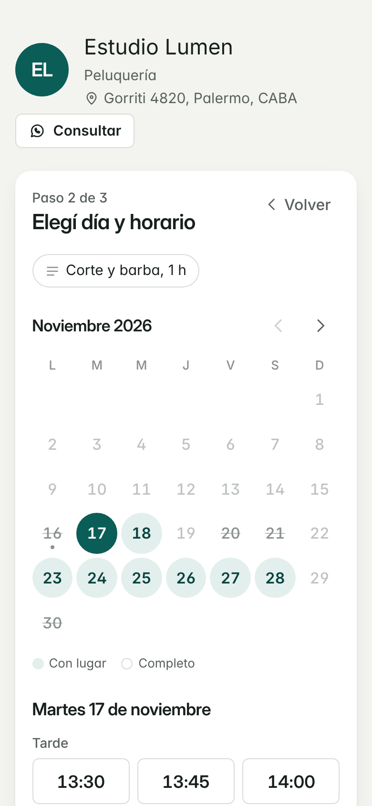
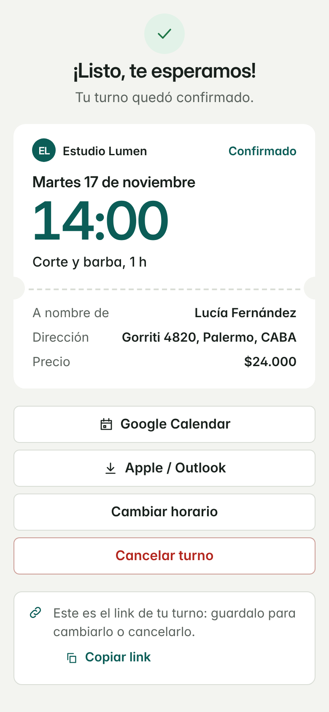
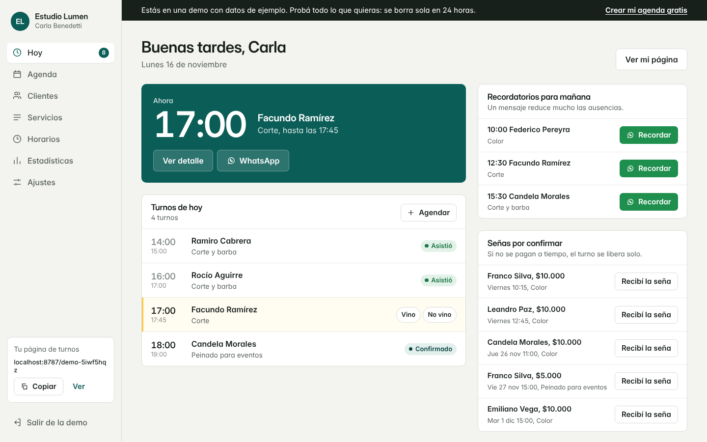

# Puntual

**Turnos online para profesionales independientes: tus clientes reservan solos, vos atendés.**

Puntual es una agenda online para peluquerías, consultorios, estudios, profes particulares y cualquier trabajo con turnos. El profesional configura sus servicios y horarios y comparte un link. Sus clientes eligen día y hora desde el celular, reciben un comprobante y pueden cambiar o cancelar el turno solos. El profesional ve todo en un panel con recordatorios por WhatsApp, señas, lista de espera y estadísticas.

**[Ver la demo →](https://puntual-asy.pages.dev)**: en la portada, "Probar el panel con datos de ejemplo" abre una peluquería con seis meses de historia, sin registrarse.

| Página de reservas (celular) | Comprobante |
|---|---|
|  |  |



## El problema

Quien trabaja por su cuenta pierde horas coordinando turnos por WhatsApp ("¿tenés algo el jueves?"), sufre las ausencias sin aviso y los huecos que nadie llena. Las herramientas que existen suelen ser caras, estar en inglés o no contemplar cosas muy de acá: seña por alias, recordatorio por WhatsApp, horario partido.

## Qué hace

**Para el cliente** (sin crearse una cuenta)
- Elige servicio, día y hora en un calendario que solo muestra horarios libres reales.
- Recibe un **ticket del turno** con link propio para cambiarlo o cancelarlo, y lo agrega a Google Calendar, Apple u Outlook (.ics).
- Si el día está completo, se anota en la **lista de espera** y le avisan cuando se libera un lugar.
- Si el servicio pide **seña**, ve el alias para transferir (con botón para copiarlo) o paga con **Mercado Pago**.

**Para el profesional**
- **Hoy**: el turno en curso en grande, la lista del día con botones de "Vino" y "No vino", recordatorios de mañana por WhatsApp con un toque, señas pendientes y lista de espera.
- **Agenda** semanal o diaria: turnos coloreados por estado, horas cerradas rayadas, la hora actual marcada, y clic en un hueco para agendar.
- **Clientes**: ficha con historial, ausencias, gasto total y notas privadas.
- **Servicios** con duración, descanso entre turnos, precio y seña.
- **Horarios** con horario partido, feriados, vacaciones y días extra.
- **Estadísticas**: cobrado, turnos atendidos, ausentismo y clientes, comparados con el período anterior. Además, cobrado por semana, servicios más pedidos y un mapa de calor de días y horarios.
- **Ajustes**: link propio (`puntual.app/tu-negocio`), color de la página, reglas de anticipación y cancelación, y seña por alias o Mercado Pago.
- Exportación de todos los turnos a CSV (Excel).

**Automático**
- Las señas impagas vencen solas y liberan el horario.
- Recordatorio por mail el día anterior y aviso de confirmación con el archivo de calendario adjunto (opcional, con [Resend](https://resend.com)).
- Cuando alguien cancela, se avisa a la lista de espera de ese día.

## Cómo está hecho

```
          Navegador                               Servidor (el mismo código en los dos entornos)
 ┌─────────────────────────┐          ┌───────────────────────────────────────────────┐
 │ index.html   portada    │  fetch   │ app.js     rutas, sesiones, CSRF, límites     │
 │ reserva.html clientes   │ ───────► │ agenda.js  horarios libres, políticas, stats  │──► D1 (Cloudflare)
 │ panel.html   profesional│  JSON    │ avisos.js  .ics, Google Calendar, correos     │    o node:sqlite
 └─────────────────────────┘          │ bd.js      esquema + adaptador D1 / SQLite    │
                                      └───────────────────────────────────────────────┘
```

- **Sin frameworks ni dependencias en producción.** El frontend usa módulos ES nativos y el backend solo APIs web estándar (`Request`, `Response`, `crypto.subtle`). El mismo `manejar(pedido, env)` corre en **Cloudflare Pages + D1** y en **Node 22 con `node:sqlite`** para desarrollo y pruebas.
- **Sin dobles reservas.** Cada turno se inserta con una sola sentencia `INSERT … SELECT … WHERE NOT EXISTS (superposición)`. Aunque dos personas confirmen el mismo horario en el mismo milisegundo, solo una lo consigue. Además, el servidor vuelve a calcular los horarios libres antes de aceptar la reserva.
- **Cálculo de horarios** como función pura y probada: tiene en cuenta franjas partidas, excepciones, duración, descanso posterior de cada turno, anticipación mínima y máxima, y la zona horaria del negocio (`Intl.DateTimeFormat`).
- **Seguridad**:
  - contraseñas con PBKDF2-SHA256 (100.000 iteraciones, el máximo de Workers) y sal aleatoria;
  - sesiones con token aleatorio en cookie `HttpOnly; SameSite=Lax; Secure`, guardado en la base solo como hash;
  - comparación en tiempo constante y tiempo de respuesta parejo al ingresar, para no revelar qué emails existen;
  - verificación de `Origin` contra CSRF;
  - límites de intentos por IP y por email;
  - trampa invisible contra robots en las reservas y máximo de turnos activos por teléfono;
  - CSP estricta sin `unsafe-inline`;
  - la página pública nunca expone datos de otros clientes;
  - los avisos de pago de Mercado Pago se verifican consultando el pago a su API, nunca confiando en el aviso.
- **Tareas programadas** (vencer señas, recordatorios, limpiar demos) con Cron de Cloudflare, con `POST /api/cron` o, si no hay nada configurado, aprovechando las visitas (como máximo una vez cada 10 minutos).
- **Accesibilidad**:
  - navegación completa con teclado, incluido el calendario con flechas;
  - foco visible y foco al título al cambiar de pantalla;
  - `aria-live` para avisos y resultados;
  - el estado de un turno nunca se indica solo con color;
  - cada gráfico tiene su tabla equivalente;
  - se respeta `prefers-reduced-motion`.
- **Diseño**: el ticket de turno con troquel es el elemento distintivo. Se usa Inter Display con números tabulares para las horas, y cada negocio elige su color (seis opciones probadas en contraste).

## Probarlo en tu computadora

Requiere **Node 22.5 o más nuevo** (trae SQLite incorporado). No hay que instalar nada.

```bash
npm run dev            # node servidor/node.js  →  http://localhost:8787
```

Los datos quedan en `puntual.db`. En la portada, "Probar el panel con datos de ejemplo" crea una cuenta de demostración.

## Pruebas

```bash
npm test               # 16 pruebas: lógica de agenda + API completa contra SQLite en memoria
npm run test:e2e       # 12 recorridos en navegador real (Playwright)
```

Las pruebas de la API recorren:

- registro, ingreso y sesiones;
- CSRF y límites de intentos;
- reserva pública completa con superposición, reprogramación, cancelación y .ics;
- excepciones y lista de espera;
- seña que vence sola;
- la demo con estadísticas.

Las de punta a punta recorren:

- un profesional que se registra y configura;
- un cliente que reserva desde el celular, cambia el horario y cancela;
- el profesional que ve el turno, la imposibilidad de reservar un horario ocupado y la seguridad del panel.

## Publicarlo gratis

En **[GUIA-DESPLIEGUE.md](GUIA-DESPLIEGUE.md)** está el paso a paso para Cloudflare Pages con base de datos D1. Es gratis y se actualiza solo con cada push a GitHub. `npm run build` genera `dist/` con un único `_worker.js` que junta todo el servidor.

## Estructura

```
servidor/
  agenda.js      lógica pura: fechas, franjas, horarios libres, políticas, estadísticas
  app.js         rutas de la API, sesiones, reservas, tareas programadas, archivos estáticos
  avisos.js      .ics, Google Calendar, plantillas de correo (Resend)
  bd.js          esquema SQL y adaptadores D1 / node:sqlite
  demo.js        peluquería de ejemplo con seis meses de historia
  util.js        criptografía, cookies, validación
  node.js        servidor para desarrollo
public/
  index.html     portada
  reserva.html   página pública de reservas y de cada turno (/negocio, /t/token)
  panel.html     panel del profesional (/panel, /ingresar, /registro)
  css/ js/ fonts/ img/
scripts/construir.mjs   arma dist/ para Cloudflare
tests/                  unitarias e integración (node:test) y punta a punta (Playwright)
```

## Licencia

MIT. Las fuentes Inter e Inter Display usan la licencia SIL Open Font License.
